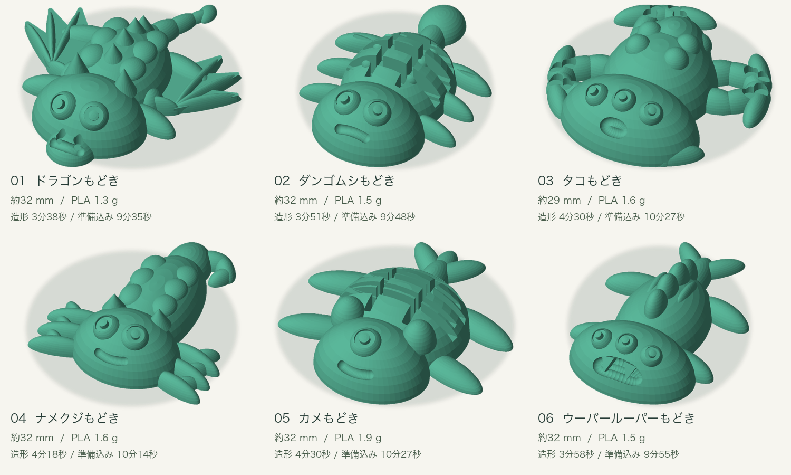

# へんてこ生物研究所 / Creature Lab

iPad miniでパーツを選び、オリジナル生物を3Dプリントする体験会向けアプリです。iPad miniの縦画面を中心に、Macを計算・印刷準備用サーバーとして使います。



## できること

- 説明のあと、からだ・あたま・あし／うで・しっぽ・目の数・表情を各最大1分で選択。決まったら早く次へ進めます。
- 実際のモデルを3Dで回転・拡大。目と口は頭部形状に合わせて自動配置します。
- 大きさ、ふっくら具合、しっぽの長さ、目の大きさは自動調整します。
- 閉じた単一立体のSTLとBambu Studio用3MFを生成。造形5分以内を目標に32 mmから25 mmまで最大3回調整します。
- 印刷は **A1 mini / 0.6 mm / PLA / 標準100% / 0.30 mm** に固定。
- Macのモニターで選択・進捗・完成形・印刷依頼を確認できます。

## 必要なもの

- macOS、Python 3.12推奨、Bambu Studioを `/Applications/BambuStudio.app` にインストール
- Macと通信できるWi-Fiに接続したiPad mini（Safari）
- 0.6 mmノズルを装着したA1 miniとPLA
- MacのBambu Studioから通常のクラウド接続で印刷できる環境

スライスを含む現行構成はmacOS向けです。Bambu Studio本体やPython環境は同梱していません。

## 起動

```sh
git clone https://github.com/koh-nakagawa/creature-lab.git
cd creature-lab
python3 -m venv .venv
.venv/bin/python -m pip install -r requirements.txt
.venv/bin/python server.py
```

Macで http://127.0.0.1:8765/ を開きます。Macの右上のスタッフ設定に表示されるURLをiPad Safariで開き、同じ画面に表示される6桁の接続コードでiPadを接続します。Macサービスは起動したまま使います。

Macのスタッフ画面は http://127.0.0.1:8765/studio-queue.html です。接続コードは再起動時に変わります。実行データは `runtime/` に生成されます。

### Mac用の起動アプリ

```sh
brew install tmux
.venv/bin/python package_mac.py
```

生成された `へんてこ生物研究所.app` をこのフォルダ内で開きます。プロジェクトの `.venv` を参照するランチャーで、単独配布用バイナリではありません。Pythonは `CREATURE_LAB_PYTHON` で変更できます。起動後はTerminalでtmuxの実行ログを確認できます。

## 印刷の流れ

1. iPadで作成を完了すると、Macでモデル生成と自動スライスが進みます。
2. iPadから「Macへ印刷をお願いする」で印刷待ちに追加します。
3. Macの該当作品を「Bambu Studioで開く」で読み込みます。
4. スタッフがプリンター・ノズル・フィラメント・プレートを確認し、公式Studioから印刷します。

キューへの受付やStudioを開く操作では印刷は始まりません。アプリにBambuのログイン情報を保存する必要はありません。A1 miniはWi-Fiで接続します。旧LAN直接送信の試作コード `printer_transport.py` と自由編集画面は開発履歴用に残していますが、通常の体験はStudio経由です。

## 作例・配布物

- [作例6種類と印刷手順](example_prints_fangs_v2_20261107/README_印刷手順.md)：STL・レシピ・編集用3MF・スライス済み3MF・画像
- [A3フライヤー](event_materials_20261107/output/pdf/へんてこ生物研究所_A3フライヤー.pdf)
- [A4体験説明書](event_materials_20261107/output/pdf/へんてこ生物研究所_A4体験説明書.pdf)

配布物の参加費表記は1回500円、所要時間は約15分です。全6段階で1分ずつ使う場合や印刷待ちによっては15分を超えます。CLIの印刷見積もりと、実機での準備・冷却・受け取り時間は異なります。

## スクリプト

| ファイル | 用途 |
| --- | --- |
| `server.py`, `workshop.py` | API、6段階タイマー、自動サイズ調整 |
| `geometry.py`, `geometry_support/` | 生物形状、目・口の自動配置、メッシュ検証 |
| `slicer.py`, `slicer_seed.json` | Bambu Studio CLIでスライスと設定検証 |
| `studio_handoff.py` | 印刷キュー、重複防止、SHA256検証、Studioへの受け渡し |
| `frontend/` | iPad用画面、3Dビューア、Macモニター、サムネイル |
| `launch.py`, `package_mac.py` | Mac用ランチャー作成・起動 |
| `generate_thumbnails.py`, `part_previews.py`, `refresh_part_thumbnails.py` | 実形状から画像／部位だけの見本を生成 |
| `build_example_prints_20261107.py` | 作例6種類と同時印刷プレートを生成 |
| `validate_*.py`, `diagnose_*.py`, `tests/` | 形状・顔・印刷受け渡しの開発用検証 |
| `event_materials_20261107/*.py` | A3／A4配布物と画像を生成 |

作例生成の出力先は `example_prints_20261107/` です。既存の出力先があると上書きせず停止します。部位サムネイルは新しい作業先へステージングします。一回限りの更新検証スクリプトには、過去の出力・バックアップを入力にするものもあります。

配布物の再生成：

```sh
.venv/bin/python -m pip install -r requirements-materials.txt
.venv/bin/python event_materials_20261107/build_materials.py
```

同梱PDFを上書きするため、編集前にコピーを保存してください。

## 検証

```sh
.venv/bin/python -m unittest discover -s tests -p 'test_*.py' -v
.venv/bin/python tests/test_geometry.py runtime/geometry_check_new
```

メッシュ検証は新しい空の出力先を指定します。HTTP検証は**テスト用サーバー**に対して行ってください。`tests/integration_studio.py` はポート8766で実際にモデル生成・スライス・キュー登録を行いますが、Studioを開く操作や印刷は行いません。

```sh
.venv/bin/python server.py --host 127.0.0.1 --port 8766
# 別のTerminalから
.venv/bin/python tests/integration_studio.py
```

現行の主な回帰確認は `test_workshop.py`, `test_studio_handoff.py`, `test_live_monitor.py`, `test_transport.py`, `tests/test_geometry.py` です。旧 `tests/integration.py` はLAN直接送信時代の期待値を含みます。すべての組み合わせ・端末・ファームウェアは未検証です。Bambu Studioのプロファイル構成が変わった場合はスライサー側の追従が必要です。

## 公開範囲とライセンス

接続情報、参加者の作品名・IP、ペアリング情報、印刷キュー、ログ、ローカル実行履歴、バックアップは含めていません。生成先は `.gitignore` で除外しています。サーバーは同一Wi-Fi内で使う構成です。インターネットへ公開するWebサービスとしての構成は含みません。

第三者の素材・設定のライセンスは [THIRD_PARTY_NOTICES.md](THIRD_PARTY_NOTICES.md) を参照してください。自作部分の再利用ライセンスは未設定です。
